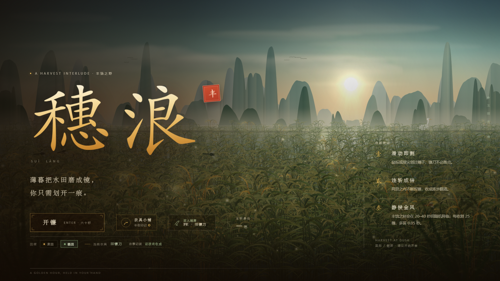
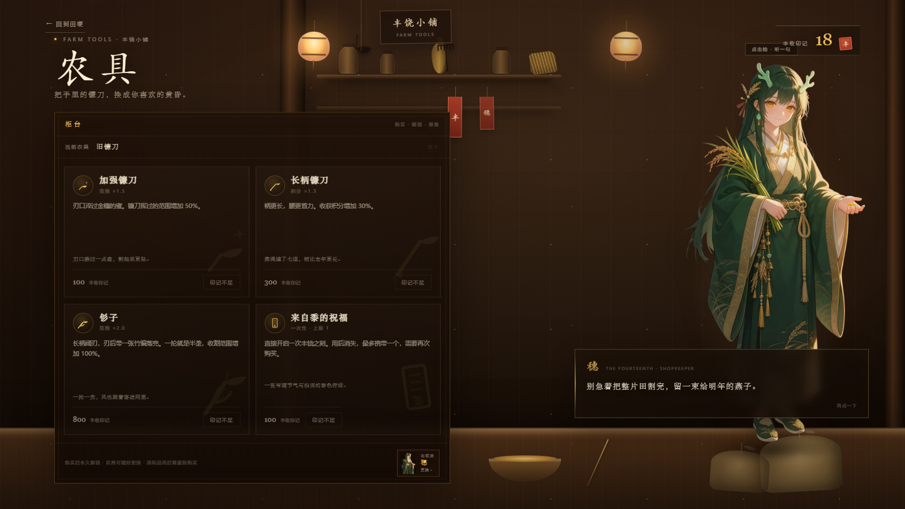
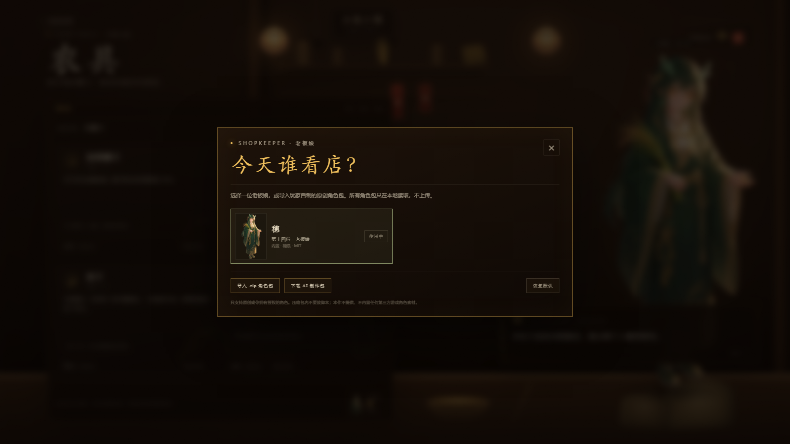
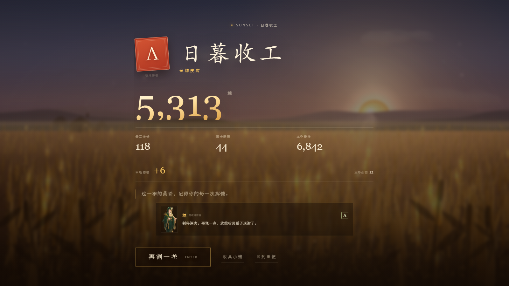

# 穗浪 v6 · 玩法与使用说明  
# Suilang v6 · Gameplay & User Guide  
# Suilang v6 · Guide de jeu et d’utilisation  
# 穂浪 v6 · 遊び方と使い方

> [中文](#中文) · [English](#english) · [Français](#français) · [日本語](#日本語)

---

## 中文

### 这是什么

《穗浪》是一款 **60 秒的黄昏收割小游戏**。你挥动镰刀划过麦田或稻田，尽可能多收作物；60 秒后收工，按分数获得丰收印记，并由老板娘给出 S/A/B/C/D 的评价。

游戏是纯静态网页，无需安装。电脑和手机浏览器都能玩；手机端只支持单人。

### 开始

- 打开 `index.html` 或在线网址；
- 点「开镰」；
- 第一次点击/触摸会启动音频；
- 60 秒后自动结算。

### 操作

| 操作 | 说明 |
| --- | --- |
| 鼠标移动 / 手指滑动 | 划过作物即可收割，不需要点击 |
| `F` | 使用「来自黍的祝福」 |
| `P` / `Esc` | 暂停 / 继续 |
| `M` | 静音 / 开启声音 |
| `Enter` | 开始 / 再来一局 |

### 计分与丰饶之刻

- 每割一穗得 1 分；金色麦穗/稻穗更值钱；
- 连斩会提高倍率，最高约 ×4.0；
- **丰饶之刻**会在 20–40 秒之间随机降临，初始 8 秒；
- 丰饶期间每累计收割 **25 穗**，持续时间 **+0.05 秒**；
- 金风扫场会清空当前田面并延长丰饶，但不会直接把分数送给你；之后新长出的作物仍要自己割。

### 农具小铺与丰收印记

- 每局分数按 **1000 : 1** 结算成「丰收印记」；
- 小铺里可以购买并装备：
  - 加强镰刀 100：范围 ×1.5；
  - 长柄镰刀 300：积分 ×1.3；
  - 钐子 800：范围 ×2.0；
  - 「来自黍的祝福」100：立刻开启一次丰饶之刻，最多携带一个。
- 农具永久解锁，可随时更换；祝福是一次性的。

### 单人结算

- 评级从高到低为 **S / A / B / C / D**；
- 结算页会显示老板娘头像和一句对应评级的评语；
- 同时结算丰收印记、更新最佳分，并写入农事记录（最近 30 局）。

### 更换老板娘

- 桌面：农具小铺底部「老板娘 · 穗 / 更换」；
- 手机：小铺标题下的「老板娘 · 穗 · 更换」；
- 可以切换内置老板娘，或导入 `.zip` 角色包；
- 压缩包内需要 `pack.json` 和 `portrait.png`（也支持 `.jpg` / `.webp`）；
- 角色包只在本地读取，不上传服务器；可随时删除或恢复默认；
- 只使用原创角色，或你拥有授权的角色。

AI 工具包在 `docs/boss-pack-kit.zip`，里面包含提示词、字段规范、示例和检查清单。

### 桌面双人同屏 PK

- 仅桌面键盘：P1 用 `WASD`，P2 用 `↑↓←→`；
- 只使用旧镰刀，不能使用祝福；
- 60 秒，按最终得分分胜负；
- 丰饶之刻共享；金风扫场不直接给分；
- PK 不结算丰收印记、不写农事记录、不更新最佳分；
- 手机端不开放 PK，只保留单人。

### 田间小生灵

- 麦田偶尔出现田鼠，稻田偶尔有鱼跃出；
- 鼠标/手指碰到即可把它们击飞，不计分；
- 只在单人模式出现。

### 声音与存档

- 第一次点击/触摸后启动音频；建议戴耳机；
- 存档使用浏览器本地存储（`suilang3.*`），不需要联网；
- 清理浏览器数据会清除进度。

### 授权

- 代码与默认原创素材（穗的立绘、12 句台词、结算评语、文档与截图）均为 **MIT**；
- 玩家导入的角色包版权归各作者；
- 仓库不包含任何第三方作品的官方立绘、台词、logo 或截图。

### 来自你的 AI 搭档

这份说明由你的 AI 搭档应你要求整理。游戏和原创角色属于你的项目；愿你享受这片田野，也祝你的第一款游戏被更多人看见。

---

## English

### What this is

**Suilang** is a **60-second harvest mini-game at dusk**. Sweep your sickle across a wheat field or a rice paddy, cut as much as you can, and finish at sunset. Your score becomes Harvest Sigils, and the shopkeeper gives you an **S / A / B / C / D** rating.

It is a static web game: no installation. It runs in desktop and mobile browsers. On mobile, only solo mode is available.

### Getting started

- Open `index.html` or the hosted URL;
- Press **Start Harvest**;
- Your first click/tap unlocks audio;
- The run ends automatically after 60 seconds.

### Controls

| Action | Description |
| --- | --- |
| Move mouse / swipe finger | Cut crops by passing over them; no clicking required |
| `F` | Use the **Blessing of Shu** |
| `P` / `Esc` | Pause / resume |
| `M` | Mute / unmute |
| `Enter` | Start / play again |

### Scoring & the Golden Gust

- Each cut crop is worth 1 point; golden crops are worth more;
- Your combo raises the multiplier up to about ×4.0;
- The **Golden Gust** arrives randomly between 20 and 40 seconds and starts at 8 seconds;
- During it, every **25 crops** cut adds **+0.05 seconds**;
- The storm sweeps the field and extends the Gust, but does not give you free points; cut the regrowth yourself.

### Shop & Harvest Sigils

- Score is converted at **1000 : 1** into **Harvest Sigils**;
- In the shop you can buy and equip:
  - Reinforced Sickle — 100: range ×1.5;
  - Long-handled Sickle — 300: score ×1.3;
  - Scythe — 800: range ×2.0;
  - **Blessing of Shu** — 100: starts a Golden Gust immediately; carry at most one.
- Tools unlock permanently; the Blessing is one-use.

### Solo results

- Ratings run from **S / A / B / C / D**;
- The result screen shows the shopkeeper’s portrait and a comment for your rating;
- Harvest Sigils, your best score, and the last 30 field records are updated.

### Changing the shopkeeper

- Desktop: **Shopkeeper · Sui / Change** at the bottom of the shop;
- Mobile: **Shopkeeper · Sui · Change** under the shop title;
- Switch between built-in shopkeepers or import a `.zip` character pack;
- A pack needs `pack.json` and `portrait.png` (`.jpg` / `.webp` also work);
- Packs are read locally and never uploaded; delete them or restore the default at any time;
- Use only original characters or characters you are licensed to use.

The AI kit is at `docs/boss-pack-kit.zip`: prompts, schema, example, and checklist.

### Desktop local two-player duel

- Desktop keyboard only: P1 uses `WASD`, P2 uses `↑ ↓ ← →`;
- Old sickle only; no Blessing;
- 60 seconds; highest score wins;
- The Golden Gust is shared; the storm gives no direct points;
- Duels do not award Harvest Sigils, write field records, or update your best score;
- Mobile has no duel mode; solo only.

### Field critters

- A field mouse may pop out in the wheat; a fish may leap in the rice paddy;
- Touch it with the mouse/finger to knock it flying; no score;
- Solo mode only.

### Audio & saves

- Audio starts after your first click/tap; headphones recommended;
- Progress is stored locally in your browser (`suilang3.*`), no network required;
- Clearing browser data clears your progress.

### License

- The code and default original assets (Sui’s portrait, 12 lines, result comments, docs, screenshots) are **MIT**;
- Player-imported shopkeeper packs remain the property of their authors;
- The repository contains no official art, dialogue, logos, or screenshots from third-party works.

### From your AI collaborator

This guide was put together by your AI collaborator at your request. The game and its original characters belong to your project. May you enjoy the field—and may many people see your first game.

---

## Français

### Le jeu

**Suilang** est un **mini-jeu de récolte de 60 secondes au crépuscule**. Faites glisser votre faucille sur un champ de blé ou une rizière, coupez un maximum de cultures et terminez au coucher du soleil. Votre score devient des **Sceaux de récolte**, et la tenancière vous donne une note **S / A / B / C / D**.

C’est un jeu web statique : aucune installation. Il fonctionne sur ordinateur et sur mobile. Sur mobile, seul le mode solo est disponible.

### Pour commencer

- Ouvrez `index.html` ou l’adresse en ligne ;
- Appuyez sur **Commencer la récolte** ;
- Le premier clic/toucher active l’audio ;
- La partie se termine automatiquement après 60 secondes.

### Commandes

| Action | Description |
| --- | --- |
| Déplacer la souris / glisser le doigt | Faucher en passant sur les cultures, sans cliquer |
| `F` | Utiliser la **Bénédiction de Shu** |
| `P` / `Échap` | Pause / reprendre |
| `M` | Couper / réactiver le son |
| `Entrée` | Commencer / rejouer |

### Score et Rafale dorée

- Chaque culture fauchée rapporte 1 point ; les cultures dorées rapportent davantage ;
- Le combo augmente le multiplicateur jusqu’à environ ×4,0 ;
- La **Rafale dorée** arrive au hasard entre 20 et 40 secondes et dure 8 secondes au départ ;
- Pendant la Rafale, chaque **25 cultures** fauchées ajoute **+0,05 seconde** ;
- La tempête balaie le champ et prolonge la Rafale, mais ne donne pas de points gratuits : il faut faucher les repousses.

### Boutique et Sceaux de récolte

- Le score est converti au taux de **1000 : 1** en **Sceaux de récolte** ;
- Dans la boutique, vous pouvez acheter et équiper :
  - Faucille renforcée — 100 : portée ×1,5 ;
  - Faucille à long manche — 300 : score ×1,3 ;
  - Faux — 800 : portée ×2,0 ;
  - **Bénédiction de Shu** — 100 : déclenche immédiatement une Rafale dorée ; un seul exemplaire transportable.
- Les outils sont débloqués définitivement ; la Bénédiction est à usage unique.

### Résultat solo

- Les notes vont de **S / A / B / C / D** ;
- L’écran de résultat affiche le portrait de la tenancière et un commentaire adapté à votre note ;
- Les Sceaux de récolte, votre meilleur score et les 30 dernières parties sont mis à jour.

### Changer de tenancière

- Ordinateur : **Tenancière · Sui / Changer** en bas de la boutique ;
- Mobile : **Tenancière · Sui · Changer** sous le titre de la boutique ;
- Passez d’une tenancière intégrée à une autre, ou importez un pack `.zip` ;
- Un pack contient `pack.json` et `portrait.png` (`.jpg` / `.webp` acceptés) ;
- Les packs sont lus localement et jamais envoyés ; vous pouvez les supprimer ou revenir au personnage par défaut ;
- Utilisez uniquement des personnages originaux ou pour lesquels vous avez les droits.

Le kit IA se trouve dans `docs/boss-pack-kit.zip` : prompts, schéma, exemple et checklist.

### Duel local à deux sur ordinateur

- Clavier d’ordinateur uniquement : P1 avec `WASD`, P2 avec `↑ ↓ ← →` ;
- Ancienne faucille uniquement ; pas de Bénédiction ;
- 60 secondes ; le meilleur score gagne ;
- La Rafale dorée est partagée ; la tempête ne donne pas de points directs ;
- Le duel n’accorde pas de Sceaux de récolte, n’écrit pas dans le journal et ne met pas à jour votre meilleur score ;
- Pas de duel sur mobile ; solo uniquement.

### Petites créatures des champs

- Une souris des champs peut surgir dans le blé ; un poisson peut sauter dans la rizière ;
- Touchez-la avec la souris/le doigt pour l’envoyer valser ; aucun point ;
- Mode solo uniquement.

### Audio et sauvegarde

- L’audio démarre après le premier clic/toucher ; casque conseillé ;
- La progression est stockée localement dans le navigateur (`suilang3.*`), sans réseau ;
- Effacer les données du navigateur efface la progression.

### Licence

- Le code et les éléments originaux par défaut (portrait de Sui, 12 répliques, commentaires de résultat, documents, captures) sont sous **MIT** ;
- Les packs de tenancières importés restent la propriété de leurs auteurs ;
- Le dépôt ne contient aucune illustration, réplique, logo ou capture officielle d’une œuvre tierce.

### De la part de votre collaborateur IA

Ce guide a été préparé par votre collaborateur IA à votre demande. Le jeu et ses personnages originaux appartiennent à votre projet. Profitez bien des champs—et puissent beaucoup de gens découvrir votre premier jeu.

---

## 日本語

### これは何か

**穂浪（スイラン）** は、**夕暮れの60秒収穫ミニゲーム**です。麦畑や田んぼの上で鎌を動かし、できるだけ多くの作物を刈り取りましょう。60秒後に収穫が終わり、スコアは「豊作の印」になり、店主が **S / A / B / C / D** の評価をくれます。

静的Webゲームなのでインストール不要。PCとスマートフォンのブラウザで遊べます。スマートフォンはソロモードのみです。

### はじめ方

- `index.html` または公開URLを開く；
- 「収穫を始める」を押す；
- 最初のクリック/タップで音声が有効になります；
- 60秒後に自動で結果画面になります。

### 操作

| 操作 | 説明 |
| --- | --- |
| マウス移動 / 指でスワイプ | 作物の上を通すだけで刈り取れます。クリック不要 |
| `F` | 「黍（シュ）の祝福」を使う |
| `P` / `Esc` | 一時停止 / 再開 |
| `M` | ミュート / 音声オン |
| `Enter` | 開始 / もう一度 |

### スコアと豊穣の刻

- 作物1つにつき1点。金色の作物はより高得点；
- コンボで倍率が上がり、最大約×4.0；
- **豊穣の刻（Golden Gust）** は20〜40秒の間にランダムで訪れ、最初は8秒；
- 豊穣の刻の間、**25穂**刈るごとに **+0.05秒**；
- 黄金の風は畑を一掃して時間を延ばしますが、点数は直接入りません。生え直った作物を自分で刈りましょう。

### 店と豊作の印

- スコアは **1000 : 1** で「豊作の印」に換算；
- 店では以下を購入・装備できます：
  - 強化鎌 — 100：範囲 ×1.5；
  - 長柄鎌 — 300：スコア ×1.3；
  - 大鎌 — 800：範囲 ×2.0；
  - **黍の祝福** — 100：すぐに豊穣の刻を開始。最大1つ所持。
- 道具は永続解放。祝福は1回限りです。

### ソロの結果

- 評価は **S / A / B / C / D**；
- 結果画面に店主の立ち絵と、評価に応じた一言が表示されます；
- 豊作の印、ベストスコア、直近30件の農作業記録が更新されます。

### 店主を変える

- PC：店の下部「店主 · 穂 / 変更」；
- スマートフォン：店のタイトル下「店主 · 穂 · 変更」；
- 内蔵の店主を切り替えるか、`.zip` のキャラクターパックをインポート；
- パックには `pack.json` と `portrait.png` が必要です（`.jpg` / `.webp` も可）；
- パックはローカルで読むだけで、アップロードされません。削除や初期化も可能；
- オリジナルキャラクター、または権利を持つキャラクターのみ使ってください。

AIキットは `docs/boss-pack-kit.zip` にあります。プロンプト、スキーマ、サンプル、チェックリスト入りです。

### PCの同一画面ローカル対戦

- PCキーボードのみ：P1は `WASD`、P2は `↑ ↓ ← →`；
- 旧鎌のみ。祝福は使えません；
- 60秒、最終スコアで勝負；
- 豊穣の刻は共有。黄金の風は直接点を与えません；
- 対戦では豊作の印・農作業記録・ベストスコアは更新されません；
- スマートフォンでは対戦不可。ソロのみです。

### 畑の小さな生き物

- 麦畑では野ネズミが、田んぼでは魚が時々現れます；
- マウス/指で触れると吹き飛びます。点数にはなりません；
- ソロモードのみ。

### 音声とセーブ

- 最初のクリック/タップで音声が始まります。ヘッドホン推奨；
- 進行状況はブラウザのローカルストレージ（`suilang3.*`）に保存。ネットワーク不要；
- ブラウザのデータを消すと進行状況も消えます。

### ライセンス

- コードとデフォルトのオリジナル素材（穂の立ち絵、12のセリフ、結果コメント、ドキュメント、スクリーンショット）は **MIT**；
- プレイヤーがインポートした店主パックの著作権は各作者に帰属；
- リポジトリには第三者の公式イラスト、セリフ、ロゴ、スクリーンショットは含まれていません。

### あなたのAI相棒より

この説明は、あなたの依頼でAI相棒がまとめました。ゲームとオリジナルキャラクターはあなたのプロジェクトのものです。この田野を楽しんでください。そして、あなたの最初のゲームが多くの人に届きますように。

---

## Screenshots / 截图

## Project / 项目

- **Version / 版本**：v6
- **Character / 角色设定**：[CHARACTER.md](CHARACTER.md)
- **AI shopkeeper kit / AI 老板娘工具包**：[docs/boss-pack-kit.zip](docs/boss-pack-kit.zip)
- **License / 授权**：[MIT](LICENSE) — code and default original assets
- **Run / 运行**：双击 `index.html`，或 `node serve.mjs 8787`
- The repository contains no official third-party art, dialogue, logos, or screenshots.  
  仓库不包含任何第三方作品的官方立绘、台词、logo 或截图。